# QnA Generator

**Multimodal HTML, Thread & Image-to-MCQ Platform**

> A production-grade platform transforming raw HTML exam archives, scanned screenshot bundles, and FU Overflow threads into verified, pedagogical multiple-choice questions (MCQs) with automated AI visual problem solving, self-healing grading validation, LaTeX math rendering, and interactive practice simulation.

🔗 **Live Deployment**: [https://qna-generator-eta.vercel.app](https://qna-generator-eta.vercel.app/)

---

## Table of Contents

- [Platform Architecture](#platform-architecture)
- [Key Capabilities](#key-capabilities)
  - [1. Dual AI Engine & Dynamic Model Cascade](#1-dual-ai-engine--dynamic-model-cascade)
  - [2. Self-Healing Answer Validation Engine](#2-self-healing-answer-validation-engine)
  - [3. Ingestion Pipelines & FU Overflow Integration](#3-ingestion-pipelines--fu-overflow-integration)
  - [4. Security, SSRF & Anti-Degenerative OCR Guards](#4-security-ssrf--anti-degenerative-ocr-guards)
  - [5. Interactive Practice Simulation (Quiz Player)](#5-interactive-practice-simulation-quiz-player)
  - [6. Live Studio Editor & 1-Click Repair](#6-live-studio-editor--1-click-repair)
  - [7. Multi-Format Exporter](#7-multi-format-exporter)
  - [8. AuthGate & Access Whitelisting](#8-authgate--access-whitelisting)
  - [9. Supabase Cloud Library & Multi-Tenancy](#9-supabase-cloud-library--multi-tenancy)
- [Tech Stack](#tech-stack)
- [Environment Configuration](#environment-configuration)
- [Quick Start Guide](#quick-start-guide)
- [FU Overflow Ingestion Tools](#fu-overflow-ingestion-tools)
- [Automated Verification & Test Suites](#automated-verification--test-suites)
- [Design System](#design-system)
- [License](#license)

---

## Platform Architecture

```mermaid
flowchart TD
    subgraph Ingestion["1. Multi-Channel Ingestion"]
        A1["Direct HTML / ZIP Upload (.html, .zip)"]
        A2["FU Overflow Thread URL (fuoverflow.com)"]
        A3["Tampermonkey Userscript / CLI Scraper"]
    end

    subgraph Security["2. Pre-flight & Security Gate"]
        B1["SSRF & Private IP Filter (url-security.ts)"]
        B2["Cookie-Preserving Multi-Hop Redirect (fetchWithCookies)"]
        B3["Image Pre-processing & Sharp Enhancement"]
    end

    subgraph AI["3. Multimodal Reasoning & Cascading Engine"]
        C1["Academic Course Integrity (DBI202, PRO192, MAD101...)"]
        C2["Gemini Flash Cascade (3.8 -> 3.1 -> 3.0 -> 3.5 Lite)"]
        C3["OpenRouter Vision Routing (nemotron, llama-3.2, qwen2.5)"]
        C4["Degenerative OCR Repetition Guard (ocr-guards.ts)"]
    end

    subgraph Validation["4. Self-Healing Cross-Validation"]
        D1["Sentiment-Aware Context Scoring (+Affirm / -Negate)"]
        D2["Direct Keyword Endorsement (DROP vs DELETE)"]
        D3["Explicit Letter & Mathematical Formula Extraction"]
        D4["Multi-Choice / Single-Choice Index Alignment"]
    end

    subgraph Presentation["5. Studio & Interactive Player"]
        E1["Studio Editor (Inline edit, zoom lightbox, retry unit)"]
        E2["Quiz Player (Auto / Image / Text / Desktop Split View)"]
        E3["In-memory Image Pre-fetching & Keyboard Shortcuts"]
    end

    subgraph Output["6. Cloud Storage & LMS Exporters"]
        F1["Supabase PostgreSQL & Storage Bucket (quiz-images)"]
        F2["Moodle GIFT (with weighted multi-select ~%50%)"]
        F3["Canvas Aiken, CSV Spreadsheet, Raw JSON"]
    end

    Ingestion --> Security
    Security --> AI
    AI --> Validation
    Validation --> Presentation
    Presentation --> Output
```



---

## Key Capabilities

### 1. Dual AI Engine & Dynamic Model Cascade

- **Google Gemini API**: Native Google AI Studio SDK integration defaulting to `gemini-3.8-flash`, with support for `gemini-3.1-flash`, `gemini-3.0-flash`, and `gemini-3.5-flash-lite`.
- **OpenRouter Gateway**: Connects to open vision models using the OpenAI-compatible REST API. Defaults to `openrouter/free` (auto-routing to the highest-availability free vision model), `nvidia/nemotron-3.5-super-vl:free` (1M context), `meta-llama/llama-3.2-11b-vision-instruct:free`, and `qwen/qwen2.5-vl-72b-instruct`.
- **Live Account Model Discovery**: Click **`[ DETECT MODELS ]`** in the UI settings bar to query Google AI Studio directly with your API key, listing every active model enabled for your specific account/tier.
- **Auto-Cascading Failover**: If Gemini returns rate limits (`429 Quota Exhausted`) or deprecation errors (`404`), the backend automatically falls back across the cascade without failing the entire exam batch.

### 2. Self-Healing Answer Validation Engine

LLMs occasionally write a flawless explanation proving one answer while accidentally outputting a mismatched numerical index in the JSON block (e.g. proving `DROP` in prose, but returning `0` pointing to `DELETE`). 

The platform features an automated cross-validation engine (`src/lib/answer-validation.ts`):
- **Sentiment-Aware Context Scoring**: Parses explanation sentences, penalizing choices mentioned in negative/contrasting contexts (`"keeps table structure intact"`, `"not standard SQL"`) while boosting choices in affirmative contexts (`"is used"`, `"specifically designed"`).
- **Direct Keyword & Command Endorsement**: Identifies exact subject-verb endorsements (e.g. `the DROP statement is used`, `lệnh DROP được sử dụng`) to resolve ambiguities.
- **Exact Mathematical & Formula Extraction**: Resolves formulas and calculated decimals (e.g. `F(2) = 0.75`) directly to their matching options.
- **Bilingual Pattern Support**: Natively understands English and Vietnamese exam patterns (`"đáp án đúng là"`, `"chọn đáp án B"`, `"câu lệnh được dùng"`).
- **Contradiction Auto-Healing**: Aligns server-side generation, Studio editing, and QuizPlayer simulation against a single source of truth.

### 3. Ingestion Pipelines & FU Overflow Integration

- **Direct Thread URL Ingestion**: Paste any `fuoverflow.com` thread URL. The server automatically crawls the XenForo markup, attachments, and student discussion posts.
- **Community Discussion Cross-Check**: Scrapes student answers and passes them as hints to the AI prompt to cross-examine and catch common student traps.
- **Multi-Hop Redirect Cookie Retention**: XenForo full-resolution attachments (`/attachments/q22.123/`) issue an HTTP 302 redirect. A custom redirection engine (`fetchWithCookies`) retains `Cookie`, `User-Agent`, and `Referer` headers across redirects to bypass guest anti-leech watermarks and fetch full-HD 1800px images.
- **Multi-Format Local Uploads**: Drag-and-drop `.html`, `.htm`, or `.zip` archives containing HTML files and associated image assets.
- **Server-Side Image Processing**: Powered by Sharp to convert transparency channels, normalize DPI, and sharpen diagrams for optimal OCR transcription.

### 4. Security, SSRF & Anti-Degenerative OCR Guards

- **SSRF & Private IP Blocking (`src/lib/url-security.ts`)**: Strict validation on remote URLs. Blocks `localhost`, loopback addresses (`127.0.0.1`), RFC1918 private subnets (`10.0.0.0/8`, `172.16.0.0/12`, `192.168.0.0/16`), link-local IPs, cloud metadata endpoints (`169.254.169.254`), and unauthorized ports.
- **Anti-Degenerative OCR Loop Detection (`src/lib/ocr-guards.ts`)**: Detects repetitive token loops (e.g. repeating syntax 20+ times) or low-entropy gibberish, terminating bad outputs and triggering a model retry with elevated temperature.
- **Academic Course Context Integrity**: Regex-extracts course subject codes from the title (e.g., `DBI202` for Databases, `PRO192` for Java, `MAD101` for Discrete Math, `CSD201` for Data Structures). Enforces prompt constraints to prevent the model from hallucinating elementary math (like `2x + 5 = 13`) on university-level exams.
- **Filename Stub Protection**: Prevents image-less HTML references from burning API tokens.

### 5. Interactive Practice Simulation (Quiz Player)

- **4 Dynamic View Modes**:
  - `[ AUTO ]`: Automatically selects visual mode for diagrams/graphs/circuits and text mode for standard questions.
  - `[ 🖼️ ALL IMAGE ]`: Displays the authentic original exam screenshot.
  - `[ 📝 ALL TEXT ]`: Displays digitized text with LaTeX formulas and syntax-highlighted code.
  - `[ ⚡ SPLIT VIEW ]`: Desktop side-by-side mode (diagram on the left, choices and explanations on the right).
- **Multi-Select Question Support**: Supports both single-choice and multiple-choice questions ("Select all that apply") with multi-selection badges and strict grading.
- **In-Memory Image Pre-fetching**: Silently pre-loads adjacent question images ($N-1$, $N+1$, $N+2$) in memory for instantaneous navigation without loading spinners.
- **Keyboard Navigation**: Native `ArrowLeft` and `ArrowRight` shortcuts for rapid test-taking.
- **Score Analytics**: Full percentage calculation, question jump palette with answered/unanswered badges, and collapsible solution accordions.

### 6. Live Studio Editor & 1-Click Repair

- **Full Inline Editing**: Edit question stems, individual choice text, explanation write-ups, topic tags, and difficulty ratings (`Easy`, `Medium`, `Hard`).
- **Interactive Option Toggling**: Click checkbox indicators to toggle correct answers between single and multiple choices.
- **1-Click OCR / Solve Retry**: Re-process individual failed or rate-limited questions with one click without re-running the entire exam.
- **Image Zoom Lightbox**: Inspect fine diagram details, small text, or sub-indices at full resolution.
- **Clipboard Utility**: One-click raw text copy formatted with LaTeX formulas.

### 7. Multi-Format Exporter

| Format | Extension | Key Features |
| :--- | :--- | :--- |
| **Moodle GIFT** | `.txt` | Supports single choice (`=Correct ~Wrong`) and weighted multi-select (`~%50%Choice1 ~%50%Choice2`). Escapes special characters (`{`, `}`, `=`). |
| **Canvas Aiken** | `.txt` | Industry-standard LMS import format. Formats clean `A. ... B. ... ANSWER: B` blocks. |
| **Spreadsheet CSV** | `.csv` | Formatted table with Question, Options A–D, Correct Answer, Explanation, Topic, Difficulty, and Image URL. Properly escapes commas and quotes. |
| **Raw JSON** | `.json` | Full structured schema preserving Base64 image payloads, MIME types, view preferences, and multi-select indices for programmatic re-import. |

### 8. AuthGate & Access Whitelisting

- **Zero-Setup Admin Bootstrap**: The master administrator account (`PRIMARY_ADMIN_EMAIL`) automatically initializes on first password entry via `/api/auth/setup-admin`.
- **Dual Authentication Modes**: Supports both Master Password login and OTP magic link verification.
- **Domain & Email Whitelist**: Configure access via environment variables with support for exact email addresses (`user@domain.com`) or entire academic domains (`@fpt.edu.vn`). Wildcard `*` allows open access.
- **Client-Side & Server-Side Dual Key Mode**: Supports both shared server keys (`ALLOW_SERVER_KEY_FALLBACK=true`) and individual user-provided API keys in the settings bar.

### 9. Supabase Cloud Library & Multi-Tenancy

- **Persistent Quiz Storage**: Save generated quizzes to PostgreSQL (`quizzes`, `questions`, and `quiz_attempts` tables).
- **Automated Cloud Storage**: Automatically uploads extracted exam diagrams and screenshots into the `quiz-images` Supabase storage bucket.
- **Multi-Tenant Isolation**: Row-Level Security (RLS) ensures users can access and manage their own quizzes, or view public community collections.
- **Fully Optional**: The entire application (generation, studio editing, practice quiz, and exports) operates seamlessly in standalone mode without Supabase configured.

---

## Tech Stack

| Domain | Technology | Purpose |
| :--- | :--- | :--- |
| **Frontend Framework** | [Next.js 14](https://nextjs.org/) (App Router) | Server-side rendering, client interactive components, API routes |
| **Language** | [TypeScript 5.9](https://www.typescriptlang.org/) | Strict type-safety across all components and pipelines |
| **Styling** | [Tailwind CSS 3.4](https://tailwindcss.com/) | Modern brutalist design system (flat, zero-radius, hard shadows) |
| **AI Vision (Primary)** | [Google Generative AI SDK](https://www.npmjs.com/package/@google/generative-ai) | Multimodal visual problem solving (`gemini-3.8-flash`) |
| **AI Vision (Gateway)** | [OpenRouter REST API](https://openrouter.ai/) | Free and open vision models (Nemotron, Llama 3.2, Qwen 2.5) |
| **Math Typesetting** | [KaTeX](https://katex.org/) | LaTeX rendering for formulas, equations, matrices, and symbols |
| **Image Pipeline** | [Sharp](https://sharp.pixelplumbing.com/) | Server-side image resizing, metadata extraction, unsharp masking |
| **HTML Parsing** | [Cheerio](https://cheerio.js.org/) | Fast server-side DOM scraping for XenForo and HTML uploads |
| **Archive Ingestion** | [JSZip](https://stuk.github.io/jszip/) | Unzipping and extracting local `.zip` exam image bundles |
| **Database & Auth** | [Supabase](https://supabase.com/) | PostgreSQL, Storage Buckets, and Row-Level Security |
| **Icons** | [Lucide React](https://lucide.dev/) | Consistent interface iconography |

---

## Environment Configuration

Create a `.env.local` file in the project root:

```env
# ==============================================================================
# AI PROVIDER KEYS (Optional — can also be entered directly in the web UI)
# ==============================================================================
GEMINI_API_KEY=your_gemini_api_key_here
OPENROUTER_API_KEY=your_openrouter_api_key_here

# Enable server keys as a fallback for users without individual keys
ALLOW_SERVER_KEY_FALLBACK=true

# ==============================================================================
# FU OVERFLOW INTEGRATION (Optional — for Full-HD 1800px attachment downloads)
# ==============================================================================
FUO_COOKIE=xf_user=your_xenforo_cookie_here; xf_session=your_session_cookie_here

# ==============================================================================
# SUPABASE CONFIGURATION (Optional — needed for Cloud Library & Cloud Auth)
# ==============================================================================
NEXT_PUBLIC_SUPABASE_URL=https://your-project.supabase.co
NEXT_PUBLIC_SUPABASE_ANON_KEY=your_supabase_anon_key_here
SUPABASE_SERVICE_ROLE_KEY=your_supabase_service_role_key_here

# ==============================================================================
# ACCESS CONTROL & WHITELISTING (Optional)
# ==============================================================================
# Comma-separated list of allowed emails or domain wildcards
# Examples:
#   NEXT_PUBLIC_ALLOWED_EMAILS=*                     (Allow all users)
#   NEXT_PUBLIC_ALLOWED_EMAILS=@fpt.edu.vn,user@gmail.com
NEXT_PUBLIC_ALLOWED_EMAILS=

# Master admin account (automatically boots on first password entry)
PRIMARY_ADMIN_EMAIL=xhieupeo@gmail.com
```

---

## Quick Start Guide

### Prerequisites
- [Node.js](https://nodejs.org/) v18.0.0 or higher
- `npm` or `pnpm`

### 1. Clone & Install Dependencies

```bash
git clone https://github.com/xhieupeo/qna-generator.git
cd qna-generator
npm install
```

### 2. Launch Local Development Server

```bash
npm run dev
```

Visit [http://localhost:3000](http://localhost:3000) in your browser.

### 3. Build & Verify for Production

```bash
npm run build
npm run start
```

---

## FU Overflow Ingestion Tools

The repository includes 3 distinct methods for extracting exams from `fuoverflow.com`:

```
┌─────────────────────────────────────────────────────────────┐
│                 FU OVERFLOW EXTRACTION MODES                │
├──────────────────────────────┬──────────────────────────────┤
│ 1. Direct Web UI (Built-in)  │ Paste URL in app interface   │
│ 2. Tampermonkey Userscript   │ 1-Click floating button      │
│ 3. CLI Terminal Retriever    │ Node.js background scraper   │
└──────────────────────────────┴──────────────────────────────┘
```

### Option 1: Direct Web UI
1. Select the **`[ 🌐 DIRECT FU OVERFLOW URL ]`** tab on the home page.
2. Paste the target thread URL (e.g. `https://fuoverflow.com/threads/dbi202-fe-sp26.6332/`).
3. Click **`[ RETRIEVE FROM FU OVERFLOW & SOLVE ]`**.

### Option 2: Browser Userscript (`scripts/fuo-extension.user.js`)
1. Install [Tampermonkey](https://www.tampermonkey.net/) in Chrome / Firefox / Edge.
2. Create a new script and paste the contents of [`scripts/fuo-extension.user.js`](scripts/fuo-extension.user.js).
3. Navigate to any thread on `fuoverflow.com`. A floating brutalist **`[ ⚡ EXPORT TO QNA GENERATOR ]`** badge will appear in the top-right corner to package all images and post directly into your generator.

### Option 3: Terminal CLI Scraper (`scripts/retrieve-fuoverflow.mjs`)
```bash
node scripts/retrieve-fuoverflow.mjs --url "https://fuoverflow.com/threads/dbi202-fe-sp26.6332/"
```
Saves `fuoverflow_latest_ready.html` locally, complete with inline image attachments ready for drag-and-drop.

---

## Automated Verification & Test Suites

The codebase includes automated test suites in the `scripts/` directory:

```bash
# Verify answer cross-validation engine (DROP vs DELETE sentiment scoring)
node scripts/test-drop-vs-delete-grading.mjs

# Verify LaTeX, formula, and mathematical answer extraction
node scripts/test-math-answer-detection.mjs

# Verify SSRF guards, private IP blocking, and OCR anti-repetition loops
node scripts/test-ocr-guards.mjs

# Verify multi-option (5-6 choices) scaling and explanation auto-repair
node scripts/test-5-options-and-explanation-repair.mjs

# Verify complete option synthesis, dummy healing, and multi-select grading
node scripts/test-judging-and-options.mjs

# Verify multi-tenant database row-level security isolation
node scripts/test-multi-tenant.mjs
```

---

## Design System

QnA Generator implements a **Precision Technical / Modern Brutalist** aesthetic designed for engineering clarity and focus:

- **Zero Border Radius**: Clean, sharp boundaries across all containers (`rounded-none`).
- **Solid High-Contrast Tones**: Pure `#0F172A` (Slate 900), `#FFFFFF`, with strict semantic accents (Emerald for success, Red for errors, Amber for visual diagram notices, Indigo for split view).
- **Hard Offset Drop Shadows**: Physical brutalist shadows (`3px 3px 0px #0F172A`).
- **Monospace Typography**: `font-mono` accents across badges, buttons, status indicators, and question tags.

---

## License

This project is open-source under the [MIT License](LICENSE).
